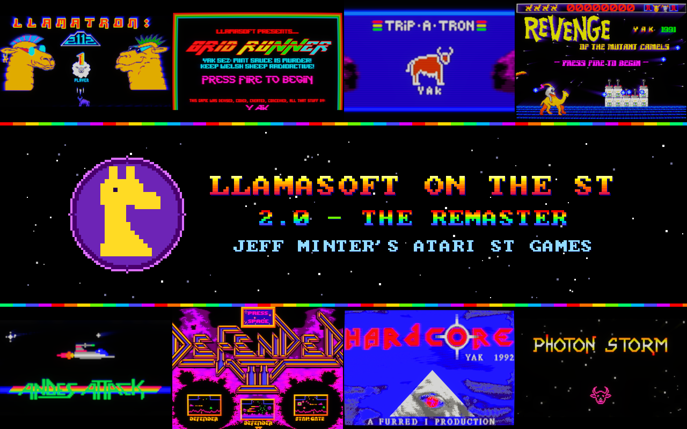

# Llamasoft on the ST



**Jeff Minter's Atari ST games, remastered for modern screens and pads, with the original game code running
untouched underneath.**

Eight games from Llamasoft's ST years:

- **Llamatron: 2112** and its bonus game **Super Gridrunner**
- **Trip-A-Tron**, the light synthesiser
- **Revenge of the Mutant Camels**: the 1 MB STE version and the TT Megamix
- **Andes Attack**
- **Defender 2**: Defender, Defender II and Stargate
- **Photon Storm**
- **Hardcore**, Yak's unfinished evaluation demo

They play at 50 frames a second on a twin-stick pad, drawn at four times the ST's resolution, gliding at your
display's full refresh rate. They respond quicker than they did on a real ST, and you can play them through a
CRT look that people who grew up with these screens will recognise.

A hobby project, not affiliated with or endorsed by Jeff Minter or Llamasoft.

## The game is the original: the remaster sits on top

This isn't a remake, a rewrite or a reimplementation from memory. Each game is the original 68000 program,
byte for byte, running in a small Atari ST built into the app. Every wave, enemy pattern, sound and score is the
game's own, computed the way it was in 1991.

The remaster sits on top of that and doesn't touch it. The app follows the game as it draws: each time it puts
a sprite on the screen, the remaster notes what it is and where it goes. Then it redraws those objects itself,
at 4x the resolution, sliding them smoothly between the game's own positions. The game never knows: its memory,
its timing and its decisions are exactly what they'd be without the remaster.

We checked that game by game, rather than just assuming it:

- **Same picture:** with the remaster on, its picture composed at the ST's own resolution matches the
  original's pixel for pixel, over minutes of scripted play on every game.
- **Same game:** the game's memory with the remaster and run-ahead on is identical to a run without them.

The few known exceptions are cosmetic and documented in `REMASTER.md`: Hardcore's two trail rings, and
Photon Storm's title stars, which the original erased in pairs.

Where we change something on purpose, it's listed below with the setting that turns it off.

## What's better

### Smooth: 50 frames a second, and every frame of your display

On a real ST these games updated the screen 13-25 times a second; the busy waves stuttered. Here the emulated
processor gets more power during play, so every game draws all 50 of its frames a second. The game logic still
runs at exactly its original speed, because it was always timed by the 50 Hz display, not by how fast the
processor could draw.

The remaster then goes further. Moving objects are drawn at four times the ST's resolution and **slide
smoothly between the game's frames** at your display's refresh rate: 60, 120 or 144 Hz. It covers play and
also:

- title screens and attract demos
- the instruction scroller
- Photon Storm's bonus tunnel and warp
- Llamatron's wave-change zoom, which builds at the display's rate
- Camels' warp between oases
- Defender 2's end-of-wave screens
- Llamatron's high score entry, where the cursor glides between letters

Trip-A-Tron is the exception: it's a light synthesiser that paints straight into the screen, with no
sprites to slide, so it runs as it always did.

Some objects get more than smoothing:

- **Photon Storm's ship turns at its exact angle.** The ST could only show 16 pre-drawn steps.
- **Llamatron's analog shots fly at their true positions** rather than jumping a pixel at a time.

### Quicker than the real thing: run-ahead

Smoothing between frames normally costs a frame of delay. Run-ahead more than wins it back: every frame, a copy
of the machine runs one or two frames ahead with your controls, and you see that future. Measured on Photon
Storm with the default setting, the picture responds about **40 ms sooner than the original game did** on its
own hardware.

### CRT+ and CRT++

**CRT+** is a CRT look built for these games:

- a soft beam with scanlines that swell on bright colours
- an aperture-grille phosphor mask
- a halation glow made from blurred linear light, rather than a fake halo
- true blacks, and colour that blooms into white when it's at its brightest

It keeps the picture its true size, in the shape it had on a UK TV in 1991.

**CRT++** adds what Minter's later games made famous: feedback trails that zoom, swirl and colour-cycle behind
everything, with composite colour bleed and a boosted glow. It's lurid, and it's on by default.

Each game has its own tuned look. Both are also included as shader presets for **ShaderGlass and RetroArch**,
so you can use them on anything else you play (`Extras\CRT shaders`, MIT licence).

### Made for a pad

Each game gets controls designed for it, not a generic joystick mapping:

- **Llamatron** is played the way it was meant, "Robotron style": left stick moves, right stick fires. Analog
  aim in any direction is an option. TEAM mode works with a second pad.
- **Photon Storm** becomes a true twin-stick shooter: steer and fly with the left stick, fire in any
  direction with the right. The original's smart bomb, boost and single-shot keys are on the triggers and
  shoulders.
- **Andes Attack and Defender 2** get arcade Defender controls: stick up and down, a reverse button, and
  analog thrust on the right trigger, where the squeeze sets your speed. In Andes Attack it accelerates frame
  for frame like the original's mouse button.
- **Super Gridrunner**, a mouse game, is steered with the stick, with the nosecone on the shoulders.
- **The Mutant Camels** spit wherever the right stick points.
- **Hardcore**'s guns follow the sticks.
- **Trip-A-Tron** becomes an instrument:
  - pressure-sensitive painting on the trigger
  - effect and symmetry wheels on the shoulders
  - a starfield you fly with the right stick
  - a music mode that listens to whatever your PC is playing
- **Menus and high score names** all work from the pad.

Around all of that:

- **Remapping:** every button can be remapped per game in Settings.
- **Button names:** controls are shown as your pad names them (Xbox, PlayStation or Switch), with
  PlayStation's symbols drawn in.
- **Rumble:** read from the game itself: a lost life, a smart bomb, every kill, the Camels' pickups and
  Hardcore's puck.

### Kinder on eyes and ears

- **Flashes:** the full-screen white flashes and red strobes are removed. Some of them could be a real risk
  for photosensitive players. Trip-A-Tron's aggressive palettes pulse gently instead, and Hardcore starts
  with its strobes off. Gameplay is untouched.
- **Volume:** every game is brought to the same broadcast loudness (EBU R128), with a master volume, so
  switching games doesn't blast you.

### A proper home for them

- **The start screen:** the disks sit on a carousel with hand-written labels. The game you're pointing at
  plays live behind it.
- **How-to-play and docs:** each game has a how-to-play page and its own docs:
  - Yak's notes from the disks
  - Gridrunner's GAME SECRETS pages
  - the full Trip-A-Tron manual (text and PDF)
  - Photon Storm's manual
- **Settings:** one panel, reachable from any game, with the game paused behind it so you see what each
  change does.
- **Steam:** the program can add itself to your Steam library with its own art, and it plays on the Steam
  Deck.
- **Your own disks:** drop any other ST disk image into `game\` and it gets a disk of its own on the carousel.

## Respecting the originals: everything we changed, and how to undo it

| Change | Why | The original |
|---|---|---|
| 50 frames a second in play | the ST couldn't keep up; the game's speed is unchanged | `--cpu=1`, or per game `grid_50fps=0`, `d2_50fps=0`, `photonstorm_50fps=0` |
| The remaster (4x, smooth motion) | modern displays | F8 / Settings: the ST's own picture |
| Run-ahead | lower latency than the original | F7 / Settings: 0 |
| CRT+ / CRT++ | the look | F9 / Settings: off |
| Screen flashes removed or calmed | photosensitivity | `--flashes`, `trip_calm_background=0`, `hc_strobes=1` |
| Photon Storm at any angle | twin-stick play | Y on its title: the original 16 directions |
| Llamatron analog aim | twin-stick play | off by default (RB on its title) |
| Andes Attack / Defender 2 arcade controls | pads have no mouse | Settings: CONTROL SCHEME; mouse and keyboard work as on the ST |
| Gridrunner: snakes shown 1.5 s before they drop | in the original they lurk half-hidden under the top rail, where shots can't reach, then drop with little warning | `--entry-lane` |
| Gridrunner: the level select unlocks the level you died on | the original unlocked the one before | `grid_unlock_level_died=0` |
| Defender 2 in its 60 Hz mode | the game's own option, as the arcade ran | `defender2_60hz=0` |
| Photon Storm: no crash in the warp | the original divides by zero about one warp in ten and crashes the ST | (a fix, not a choice) |
| The cracked releases' prompts and nag screens | these are the copies distributed today | their trainers are offered as options |

Nothing else changes: the enemies, waves, scoring, difficulty, sound and music are the originals'.

## Playing

Download the zip from [Releases](../../releases), unpack it anywhere and run `llamatron.exe`. Nothing to
install. The included `README.txt` has every game's controls and the settings. Settings and high scores are
kept in `userdata\` next to the exe.

The games come from the disks Jeff Minter distributes on his own site. Llamatron, Trip-A-Tron and Revenge were
shareware: "please spread this game everywhere". Some came on crack compilation disks; only the Llamasoft
games' own files are kept.

## How it works

The app is a high-level Atari ST: the 68000 runs on the [Musashi](https://github.com/kstenerud/Musashi)
interpreter, and the shifter, YM2149 sound chip, MFP timers, keyboard processor, STE DMA sound and enough of
TOS and GEM are emulated in C++. The disks are read straight from .msa, .st and Pasti .stx images. SDL 3
handles video, sound and pads.

The remaster hooks each game's own drawing routines: sprite blitters, dot plotters, line and terrain drawers.
Each sprite's image is decoded once, by running the game's own routine on a scratch copy of the machine, then
cached as a texture. Objects are matched between frames and interpolated, and the CRT is a multi-pass GPU
shader chain. `CLAUDE.md` and `REMASTER.md` have the full notes, down to the addresses.

## Building from source

Requirements: Windows, Visual Studio 2026 with the C++ workload and its Clang/LLVM tools (CMake and Ninja
come with it), Python 3 (only for the tools).

```
git clone --recursive https://github.com/jedeyesniv-art/Llamatron-PC-Recomp
cd Llamatron-PC-Recomp
cmd /c build.bat
```

That gives `build\llamatron.exe`. It looks for the disk images in `game\` next to the exe, the exe's folder,
or the nearest `Private\` folder up the tree. `Tools\package_portable.ps1 -Release` builds the release zip.

## Credits and licence

The games are (c) Jeff Minter / Llamasoft:

- Defender 2 was published by Arcadia (1990), Photon Storm by Arc (1990).
- Trip-A-Tron's manual was transcribed by James "Piku" Grimwood (2003).
- Photon Storm's manual was typed in by Parasite of LSD.

This project's code is MIT No Attribution (see `LICENSE`); the CRT shader presets in `crt-shaders\` are MIT.
Third-party code: SDL (zlib), Musashi (MIT-style), SoftFloat 2b, ayumi levels (MIT), miniaudio (public
domain / MIT-0). See `licenses\THIRD-PARTY-NOTICES.txt`.

Thanks, Yak. These games are as mad and as brilliant as they were in 1991.
